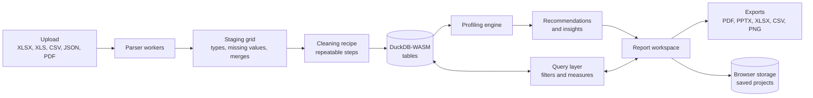
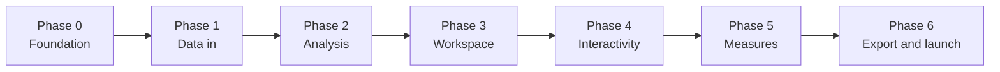

# Statistical Report Workspace: Project Plan

> **Status:** Built. This is the original plan, kept for reference. One planned choice changed during the build: an in-browser columnar engine replaced DuckDB-WASM because it measured under 300 ms for four charts on 500,000 rows without a large download. Multiple interface languages were not built.
> **Goal:** A browser-based reporting workspace that turns Excel, CSV, JSON, and PDF files into interactive, Power BI-style statistical reports, hosted free from a GitHub repository.

## Contents

1. [Summary and key decisions](#1-summary-and-key-decisions)
2. [GitHub compatibility](#2-github-compatibility)
3. [Architecture](#3-architecture)
4. [Feature plan](#4-feature-plan)
5. [Recommended improvements](#5-recommended-improvements)
6. [Delivery roadmap](#6-delivery-roadmap)
7. [Quality and release checklist](#7-quality-and-release-checklist)
8. [Upload this project to GitHub](#8-upload-this-project-to-github)
9. [Decisions needed before building](#9-decisions-needed-before-building)

---

## 1. Summary and key decisions

GitHub Pages hosts static files only. It cannot run Python, a database, or private API keys. The plan therefore runs the whole product **inside the user's browser**, which also means uploaded data never leaves their device.

| Decision | Choice | Reason |
|---|---|---|
| Hosting | GitHub Pages, deployed by GitHub Actions | Free, automatic on every push |
| App type | Static single-page app | The only type GitHub Pages can serve |
| Language and build | TypeScript, React, Vite | Strong typing for a formula engine, fast static builds |
| Data engine | DuckDB-WASM in a Web Worker | SQL aggregation and window functions in the browser |
| Charts | Apache ECharts | Wide chart coverage, events for cross-filtering, canvas speed |
| PDF tables | PDF.js plus a custom table detector | Replaces `pdfplumber` and Tabula, which need a server |
| Scanned PDFs | Tesseract.js OCR | Runs in the browser, with no paid service |
| "AI" recommendations | Transparent rules and statistics | No API key, repeatable results, every claim can be checked |
| Storage | Browser storage (OPFS and IndexedDB) | Saves work without a server or accounts |

### Changes from the original brief

| Original request | Planned approach | Trade-off |
|---|---|---|
| Python `pdfplumber` or Tabula | PDF.js table detection in the browser | Complex PDFs, such as merged cells or borderless tables, will need manual correction in the staging grid |
| AI vision models | Tesseract.js OCR first, optional server adapter later | OCR is slower and less accurate on poor scans |
| AI recommender and narratives | Rule-based engine first, optional bring-your-own-key AI later | Wording is templated, but the numbers are always computed from the data |

---

## 2. GitHub compatibility

These rules apply from the first commit.

| Constraint | Rule for this project |
|---|---|
| Pages serves static files only | No required backend. Every feature must work after `npm run build`. |
| The site lives at `/<repo-name>/` | Set Vite `base: './'` so the repository can be renamed safely. |
| Refreshing a deep link returns 404 | Use hash routes, such as `/#/report/sales`. |
| Pages cannot set COOP/COEP headers | Use single-threaded DuckDB-WASM. Do not depend on `SharedArrayBuffer`. |
| Files over 100 MB are blocked by Git | Keep samples small. Never commit `dist/`, `node_modules/`, or user data. |
| Published site limit is 1 GB | Lazy-load WASM and OCR assets, and keep a bundle budget. |
| Linux builds are case-sensitive, Windows is not | Use lowercase-kebab file names and match import casing exactly. |
| Windows and Linux line endings differ | Add `.gitattributes` with `* text=auto eol=lf`. |
| Frontend secrets are public | Never commit API keys. Optional AI keys stay in the user's browser only. |
| Pages on private repositories needs a paid plan | Use a public repository on the free plan, and never commit real data. |

### Planned repository layout

```text
statistical-report-workspace/
├── .github/
│   ├── workflows/
│   │   ├── ci.yml              # Lint, type-check, test on pull requests
│   │   └── deploy.yml          # Build and publish to GitHub Pages
│   ├── ISSUE_TEMPLATE/
│   └── pull_request_template.md
├── docs/
│   ├── PLAN.md                 # This file
│   ├── measure-language.md
│   └── screenshots/
├── public/
│   ├── samples/                # Small, synthetic datasets only
│   └── ocr/                    # Self-hosted OCR language data
├── src/
│   ├── app/                    # Routes, layout, global state
│   ├── features/
│   │   ├── ingest/             # Uploaders and parsers
│   │   ├── staging/            # Cleaning grid and recipes
│   │   ├── profiling/          # Statistics and data quality
│   │   ├── insights/           # Recommendations and narratives
│   │   ├── workspace/          # Bento canvas and fields pane
│   │   ├── visuals/            # Chart adapters and tooltips
│   │   ├── measures/           # Formula parser and SQL compiler
│   │   └── export/             # PDF, PPTX, XLSX, PNG, project files
│   ├── engine/                 # DuckDB worker and query layer
│   ├── workers/                # Parsing, profiling, OCR workers
│   ├── design-system/          # Tokens, themes, palettes, components
│   └── lib/
├── tests/
│   ├── golden/                 # Datasets with verified answers
│   └── e2e/
├── .editorconfig
├── .gitattributes
├── .gitignore
├── LICENSE
├── README.md
├── package.json
├── package-lock.json
├── tsconfig.json
└── vite.config.ts
```

### Planned deployment workflow

`.github/workflows/deploy.yml`:

```yaml
name: Deploy to GitHub Pages

on:
  push:
    branches: [main]
  workflow_dispatch:

permissions:
  contents: read
  pages: write
  id-token: write

concurrency:
  group: pages
  cancel-in-progress: true

jobs:
  build:
    runs-on: ubuntu-latest
    steps:
      - uses: actions/checkout@v4
      - uses: actions/setup-node@v4
        with:
          node-version: 24
          cache: npm
      - run: npm ci
      - run: npm run lint
      - run: npm run typecheck
      - run: npm test
      - run: npm run build
      - uses: actions/configure-pages@v5
      - uses: actions/upload-pages-artifact@v3
        with:
          path: dist

  deploy:
    needs: build
    runs-on: ubuntu-latest
    environment:
      name: github-pages
      url: ${{ steps.deployment.outputs.page_url }}
    steps:
      - id: deployment
        uses: actions/deploy-pages@v4
```

---

## 3. Architecture



### Core libraries

Pin exact versions in `package-lock.json` when the project is created.

| Need | Library | License |
|---|---|---|
| Excel parsing | SheetJS CE, installed from the official SheetJS CDN tarball | Apache-2.0 |
| CSV parsing | Papa Parse | MIT |
| PDF reading | PDF.js (`pdfjs-dist`) | Apache-2.0 |
| OCR | Tesseract.js | Apache-2.0 |
| Data engine | DuckDB-WASM | MIT |
| Charts | Apache ECharts | Apache-2.0 |
| Staging grid | TanStack Table and TanStack Virtual | MIT |
| Drag and drop | dnd-kit | MIT |
| Bento layout | react-grid-layout | MIT |
| Formula editor | CodeMirror 6 | MIT |
| App state | Zustand | MIT |
| PowerPoint export | PptxGenJS | MIT |
| Tests | Vitest and Playwright | MIT / Apache-2.0 |

> Do not install SheetJS with `npm install xlsx`. The npm registry copy is outdated and has known security advisories.

---

## 4. Feature plan

### 4.1 File ingestion and data preparation

| Feature | Approach | Done when |
|---|---|---|
| Universal uploader | Drag and drop or file picker, with type and size checks | All listed formats load, and rejected files explain why |
| Sheet and table picker | Preview each sheet or detected table, then select several | A user can import 2 of 5 sheets from a workbook |
| CSV and JSON handling | Detect delimiter and encoding, flatten nested JSON | Semicolon CSV and nested JSON become clean columns |
| PDF table extraction | Group text by position, use ruling lines, join tables across pages | Reference PDFs reach the accuracy target in Phase 0 |
| Scanned PDF OCR | Detect pages without text and offer OCR with progress | OCR values show a confidence flag and can be corrected |
| Staging grid | Virtualized grid with column type, quality, and preview | 100,000 rows scroll smoothly |
| Data fixes | Change types, fill or drop missing values, merge or split columns | Every fix is previewed, undoable, and saved in the recipe |

### 4.2 Automated analysis and smart suggestions

**Profiling engine**

| Detects | Method |
|---|---|
| Distributions | Histograms, quartiles, skewness, kurtosis |
| Numeric correlation | Pearson and Spearman, with sample size and significance |
| Categorical association | Cramér's V |
| Outliers | IQR and modified z-score (MAD) |
| Time patterns | Frequency, gaps, Mann-Kendall trend test, seasonality |

**Dashboard recommendation rules**

| Columns detected | Recommended visuals |
|---|---|
| Date + metric | Line chart, YoY % variance, KPI with sparkline |
| Category + metric | Sorted bar chart, Pareto chart |
| Category with 2 to 6 values + metric | Donut chart, or bars if slices are similar |
| Two metrics | Scatter chart with trend line and correlation |
| Two categories + metric | Heatmap or stacked bar chart |
| Region or city + metric | Ranked bar chart, or a map when geographic data is available |
| One metric only | Histogram and box plot |

**Narrative insights** are generated from verified calculations, for example:

> Category A accounts for 42.5% of total volume, up 14.2% from the previous period.

Each insight card shows its formula, filters, compared periods, and sample size. An insight appears only when its data passes the required checks, such as having two comparable periods.

### 4.3 Power BI-style workspace

| Feature | Approach | Done when |
|---|---|---|
| Cross-filter and highlight | Shared filter state, with per-visual interaction settings | One click updates all visuals within the performance target |
| Calculated measures | Formula bar, autocomplete, parser, SQL compiler | Results match the golden datasets |
| Fields pane | Drag fields to Axis, Values, Legend, Tooltips, Small Multiples | Every slot works by mouse, touch, and keyboard |
| Hierarchies | Automatic date hierarchy and custom hierarchies | Year to Quarter to Month drills up and down in one click |
| Drill-through | Open a detail page with the selected filters applied | Breadcrumbs show and restore the filter path |

**Planned measure language**

```text
Share %    = DIVIDE(SUM([Sales]), CALCULATE(SUM([Sales]), ALL([Category])))
Running    = RUNNINGSUM(SUM([Sales]), [Date])
3-Mo Avg   = MOVINGAVG(SUM([Sales]), [Date], 3)
Win Rate   = DIVIDE(COUNTIF([Status] = "Won"), COUNT([Status]))
YoY %      = DIVIDE(SUM([Sales]) - PREVIOUSYEAR(SUM([Sales])), PREVIOUSYEAR(SUM([Sales])))
```

Formulas are parsed into a validated structure and compiled to parameterized SQL. User text is never inserted directly into a query.

### 4.4 Modern UI and design system

| Feature | Approach | Done when |
|---|---|---|
| Bento grid | Responsive, resizable, rounded cards with subtle borders | Layout works from 360 px phones to wide desktops |
| Light and dark themes | Design tokens shared by the interface and charts | Switching themes updates every chart instantly |
| Colorblind-safe palettes | Validated categorical, sequential, and diverging palettes | Series also differ by label, shape, or line style |
| Rich tooltips | Exact count, % of total, variance from average, sparkline | Values match the underlying filtered query |

---

## 5. Recommended improvements

These additions are not in the original brief.

**Priority key:** **P1** = include in version 1. **P2** = add soon after launch. **P3** = later.

### Statistical accuracy

| Priority | Improvement | Why it matters |
|---|---|---|
| P1 | Correct aggregation rules | Prevents summing IDs, averages, percentages, or ratios |
| P1 | Incomplete-period detection | Stops a partial month from looking like a sudden decline |
| P1 | Small-sample warnings | "Up 100%" from 1 to 2 records should not read as a major finding |
| P1 | Correlation safeguards | Shows sample size and p-value, and never implies causation |
| P1 | Multiple-comparison correction | Scanning many columns creates false findings, so apply false discovery rate control |
| P1 | Insight audit view | Lets users check how every number was calculated |
| P2 | Simpson's paradox check | Flags trends that reverse inside subgroups |
| P2 | Confidence intervals | Shows uncertainty on means, rates, and trend lines |
| P2 | Hypothesis tests | Adds t-test, ANOVA, chi-square, and non-parametric options |
| P3 | Forecasting | Adds seasonal forecasts with ranges and backtesting |

### Data trust

| Priority | Improvement | Why it matters |
|---|---|---|
| P1 | Data quality score | Summarizes missing, duplicate, invalid, and inconsistent values |
| P1 | Reusable cleaning recipes | Applies the same steps to next month's file |
| P1 | Date and number locale settings | Resolves `03/04/2026` and `1.234,56` correctly |
| P1 | Duplicate detection | Prevents inflated totals |
| P1 | Original data preserved | Users can always return to the imported values |
| P2 | Multi-table relationships | Enables star-schema models and filters across joined tables |
| P2 | Validation rules | Flags values such as negative quantities or future dates |
| P2 | Refresh with schema-change alerts | Warns when a new file has renamed or missing columns |

### Reporting and sharing

| Priority | Improvement | Why it matters |
|---|---|---|
| P1 | Report downloads | Exports PDF, PPTX, XLSX, CSV, and PNG |
| P1 | Portable project file | Saves a report to reopen or share without a server |
| P1 | Slicers and filter pane | Gives report readers obvious filter controls |
| P1 | Undo and redo | Makes experimentation safe |
| P1 | Sample data and guided start | Shows the product's value within a minute |
| P2 | Multi-page reports and bookmarks | Supports executive, detail, and appendix views |
| P2 | Executive summary page | Combines top KPIs, changes, and risks automatically |
| P2 | Print-ready layouts | Prevents charts from splitting across pages |
| P3 | What-if parameters | Tests scenarios such as a 5% price increase |

### Security, accessibility, and performance

| Priority | Improvement | Why it matters |
|---|---|---|
| P1 | Spreadsheet formula-injection protection | Neutralizes exported cells beginning with `=`, `+`, `-`, or `@` |
| P1 | Safe file handling | Parses in workers, limits file size, and disables PDF scripts |
| P1 | Content Security Policy | Reduces cross-site scripting risk |
| P1 | Clear privacy statement | Explains that files stay in the browser and analytics are off |
| P1 | WCAG 2.2 AA accessibility | Adds keyboard drag alternatives, focus states, and contrast |
| P1 | Data table view for every chart | Supports screen readers and exact-value checks |
| P1 | Large-data handling | Uses downsampling, virtualization, cancellation, and memory warnings |
| P2 | Offline mode | Makes the app installable as a PWA |
| P2 | Multiple languages | Adds translated interface text and locale formatting |

---

## 6. Delivery roadmap

Estimates assume one full-time developer and should be reviewed after Phase 0.



| Phase | Scope | Estimate | Exit criteria |
|---|---|---:|---|
| **0. Foundation** | Repository, CI, Pages deploy, design tokens, DuckDB and PDF prototypes | 1 to 2 weeks | Demo is live on Pages, and performance and PDF targets are measured |
| **1. Data in** | Uploaders, parsers, staging grid, cleaning recipes, quality score | 3 weeks | Every format reaches a clean DuckDB table |
| **2. Analysis** | Profiling, safeguards, recommendations, narratives, audit view | 2 weeks | Golden datasets pass, and a dashboard is generated automatically |
| **3. Workspace** | Bento canvas, core charts, fields pane, themes, tooltips | 3 weeks | A user can build a report without code |
| **4. Interactivity** | Cross-filtering, slicers, hierarchies, drill-through | 2 weeks | All interactions meet performance targets |
| **5. Measures** | Parser, editor, compiler, time intelligence | 2 weeks | Measure results match verified answers |
| **6. Export and launch** | Downloads, project files, accessibility, security, documentation | 2 weeks | Release checklist is complete and `v1.0.0` is tagged |

**Total estimate:** 15 to 16 weeks.

### Phase 0 go/no-go checks

| Check | Target | If the target is missed |
|---|---|---|
| Aggregation query | Under 200 ms on 500,000 rows and 30 columns | Pre-aggregate results or lower the supported row limit |
| Cross-filter update | Under 500 ms for 6 visuals | Debounce and limit concurrent visuals |
| First load | Interface usable in under 3 seconds on broadband | Split bundles further |
| Initial JavaScript | Under 500 KB gzipped, excluding lazy-loaded WASM | Remove or lazy-load dependencies |
| Digital PDF tables | At least 95% of cells correct on the reference set | Add guided table selection or an optional server adapter |
| Scanned PDF tables | At least 85% of cells correct on clean scans | Label OCR as beta and require review |

---

## 7. Quality and release checklist

### Testing

- [ ] Unit tests for parsers, type detection, statistics, and formulas
- [ ] Golden datasets with answers verified independently in Excel or Python
- [ ] Browser tests for upload, clean, build, filter, and export
- [ ] Test files for malformed, empty, very large, and mixed-type data
- [ ] Automated accessibility checks plus a manual keyboard pass
- [ ] Latest Chrome, Edge, Firefox, and Safari checked

### GitHub readiness

- [ ] `README.md` with demo link, screenshots, setup, and limitations
- [ ] `LICENSE`, `.gitignore`, `.gitattributes`, and `.editorconfig`
- [ ] CI required before merging to `main`
- [ ] Dependabot and secret scanning enabled
- [ ] Only synthetic sample data committed
- [ ] Fresh clone passes `npm ci`, `npm test`, and `npm run build`
- [ ] Live site works after a hard refresh and on a deep link
- [ ] GitHub release created with notes

---

## 8. Upload this project to GitHub

Before the app is built, you can publish this plan on its own:

1. Sign in to GitHub and create a **public** repository named `statistical-report-workspace`.
2. Select **Add file > Upload files**.
3. Drag in `PLAN.md`, then select **Commit changes**.
4. Open the file on GitHub to confirm that the tables and diagrams display correctly.

Once the app exists:

1. Push the code to the `main` branch.
2. Open **Settings > Pages**.
3. Under **Build and deployment > Source**, choose **GitHub Actions**.
4. Open the **Actions** tab and wait for the deployment to finish.
5. Visit `https://<your-username>.github.io/statistical-report-workspace/`.

---

## 9. Decisions needed before building

| # | Decision | Recommended default |
|---|---|---|
| 1 | Can the app stay fully browser-based, with no server? | **Yes.** It is free, private, and works on GitHub Pages. |
| 2 | Is a rule-based insight engine acceptable for version 1? | **Yes.** Add optional AI after the calculations are proven. |
| 3 | What is the largest file users must handle? | **100 MB or 500,000 rows**, confirmed in Phase 0. |
| 4 | What kinds of PDFs matter most? | **Digital PDFs first**, with scanned PDFs as beta. |
| 5 | Which date and number format should be the default? | **Detect automatically**, and ask when a file is ambiguous. |
| 6 | Which interface language comes first? | **English**, with text prepared for translation. |
| 7 | Which open-source license should the repository use? | **MIT.** |
| 8 | What should the product and repository be called? | **Statistical Report Workspace** (`statistical-report-workspace`). |
